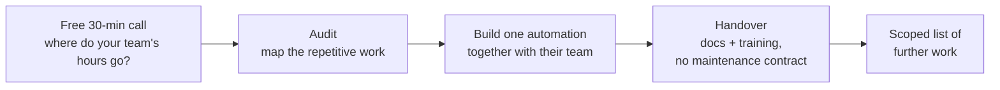
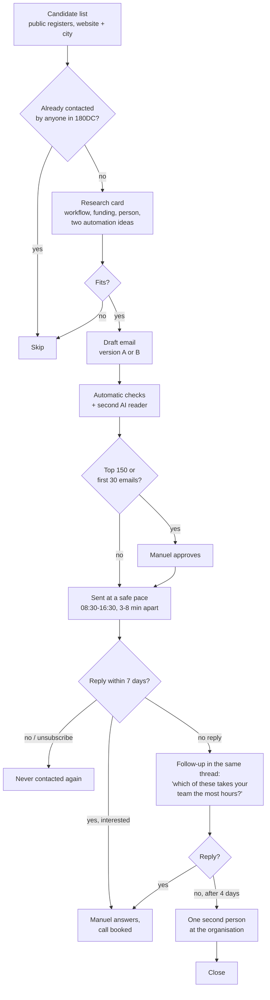
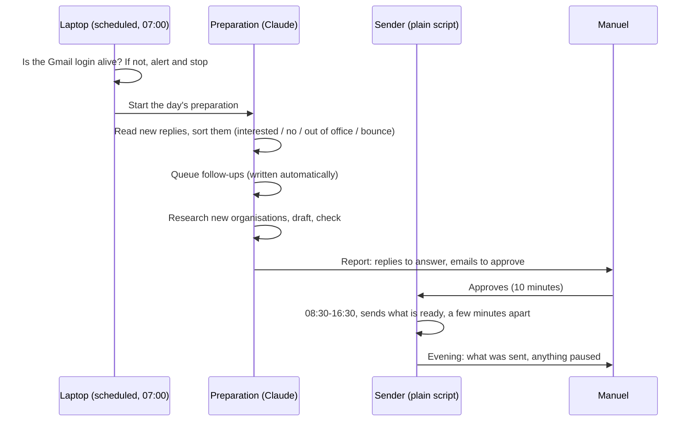
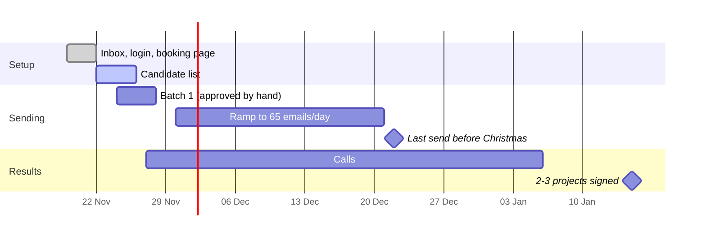

# Client outreach for 180DC Delft & Rotterdam

*Status 21 November 2026. Owner: Manuel Suhrcke (Head of AI). For the board and members who want to
know how we are finding AI-automation clients, or want to use the same system.*

---

## In one paragraph

We want **2-3 paid, interesting AI-automation projects signed by mid-January 2027**. To get there we
send short, researched emails to nonprofits, social enterprises and housing associations, about
**1,000 emails in total by 22 December**, from one 180DC inbox. Each email names two specific tasks
from the organisation's own website that we could automate, and offers a free 30-minute call. A small
system does the repetitive work: it finds organisations, finds the published contact, drafts the
email, checks it, sends it at a safe pace, follows up once after a week, and notices replies. A person
approves the important emails and takes every call.

---

## The offer

- **Price:** set after the call, depending on the organisation's funding and the task. Affordable, not free.
- **No maintenance after handover.** A student team cannot run systems after it leaves; we say so up front.
- **Language:** English, or German for Germany, Austria and Switzerland. Calls in the same language.

---

## Who we write to

| | |
|---|---|
| **Segments** | Nonprofits and foundations, social enterprises, a few housing associations (woningcorporaties) in Rotterdam |
| **Must have** | One repetitive workflow visible on their own website (intake, reporting to funders, volunteer scheduling, donor admin, case handling) and a visible funding source (subsidies, foundations, own revenue) |
| **Size** | Roughly 20-100 staff as a guide; a paid, interesting project matters more |
| **Where** | Delft and Rotterdam first, then the Randstad, then the rest of the EU |
| **Who at the organisation** | The director at smaller ones, the head of operations at larger ones; info@ with the director's name if nobody is published |

We are not sure nonprofits are the best segment, so **we work in batches of 25** and the first batch
mixes nonprofits and social enterprises on purpose. After each batch we look at the numbers and decide
the next mix.

---

## How one organisation moves through the system

**The contact sequence, per organisation:**

| Day | What happens |
|---|---|
| 0 | First email: one observation about their work, two automation ideas or our track record, a free call |
| 7 | One follow-up, same thread, one question |
| 11 | If still nothing: one email to a second person at the organisation |
| 18 | Close. Nobody gets more than two emails |

Any reply stops everything for that organisation. An "unsubscribe" or "no" puts it on a permanent
do-not-contact list.

---

## A day of the system

The AI never sends. It can only prepare. Sending is a separate plain script that re-checks every rule
right before each email.

---

## Two versions of the email (an experiment)

We alternate two versions so we learn which one gets calls:

- **Version A, track record first:** who we are and one thing we have built, then one line about their organisation.
- **Version B, value first:** two specific ideas for their workflow, then one line about who we are.

We do not draw conclusions before about 30 emails per version.

---

## How we protect 180DC

| Risk | What we do |
|---|---|
| **The 180dc.org domain is shared by every branch worldwide.** If our emails get marked as spam, everyone's mail suffers. | One inbox, slow start (20 a day, rising to 65), a few minutes between emails, no attachments, one link only, automatic pause if too many emails bounce |
| **Contacting an organisation another member is already talking to** | A shared list of who is in contact with whom (planned on monday.com); the system checks it before every email |
| **Legal (unsolicited email, GDPR)** | Reviewed by our legal team. Every email states who we are and where we found the address, and offers a one-word opt-out that is honoured permanently. We only use addresses the organisation published itself |
| **Overclaiming** | Every sentence about us comes from an approved list of claims, no usage numbers, no client names. Every fact about them needs the page it came from |
| **A bad automatic email** | Automatic checks, a second AI reader, and Manuel approves the 150 most important emails and the first 30 of all |

---

## Decisions so far

| Decision | Why |
|---|---|
| Start with finding our own clients; offering the system to clients comes later | Prove it works before selling it |
| Free call first, price after | The easiest yes for a nonprofit, and where we learn their funding |
| Audit + one automation + handover, no maintenance | What a student team can deliver well |
| English and German, no Dutch | The person taking the calls does not speak Dutch |
| Batches of 25, first batch mixes segments | Learn which segment answers before spending the list |
| One follow-up only, then one second person, then stop | Persistent enough, never pushy |
| Top 150 emails approved by a person, the rest automatic with checks | One person cannot read 1,000 emails |
| One link in the email (the booking page) | Deliverability on the shared domain |
| Signals (funding rounds, job postings) as triggers: later | Get the basic loop working first |

---

## Timeline

---

## What we measure

Every Sunday: emails sent, replies, calls booked, unsubscribes and bounces, split by email version,
by segment and by priority group. The number that matters is **calls booked**, then **projects signed**.

---

## Where we still need work

| # | Open item | Who |
|---|---|---|
| 1 | **The candidate list** (public registers of charities, social enterprises, housing associations) | Manuel + system, this week |
| 2 | First batch of 25, approved by hand | Manuel |
| 3 | Knowing which email a booking came from | System |
| 4 | **A page on the branch website about AI-automation projects**, so a careful director can check us before booking | Website team, needs board OK? |
| 5 | Standard answers to common replies ("what does it cost?", "are you students?", "can it be free?") | Manuel + board |
| 6 | **The shared contact list on monday.com**, as soon as a second person does outreach | Anyone doing outreach |
| 7 | The system runs on one laptop that must stay on during the day; a small server would be better | Later |

---

## How you can use this

- **If you write to organisations yourself:** check the shared contact list first, and add your row
  (domain, your name, status, date). Once it exists, the system will not write to anyone you are
  talking to, and you will not write to ours.
- **If you want the system for your own outreach** (a project, another branch, a client): everything
  specific to us lives in one folder (who sends, the offer, the target filter, the approved claims,
  the email templates). A second user is a copy of that folder with their own inbox. Talk to Manuel.
- **If a prospect contacts you about one of our emails:** forward it to the 180DC outreach inbox so
  the system marks the organisation as in conversation.
